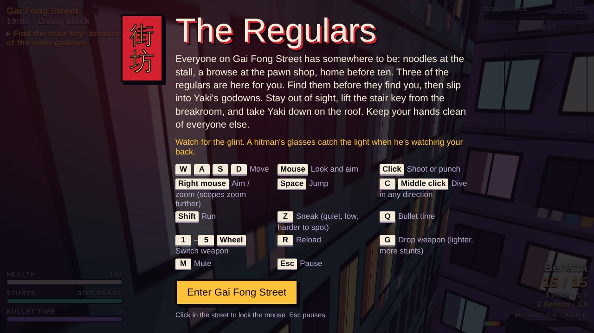
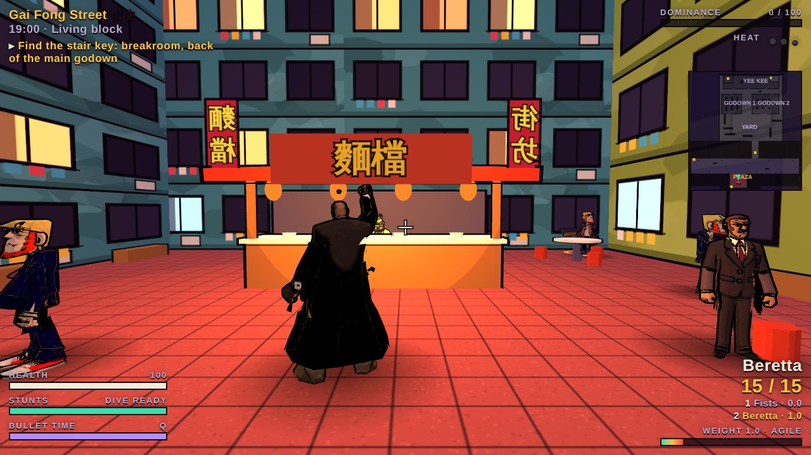
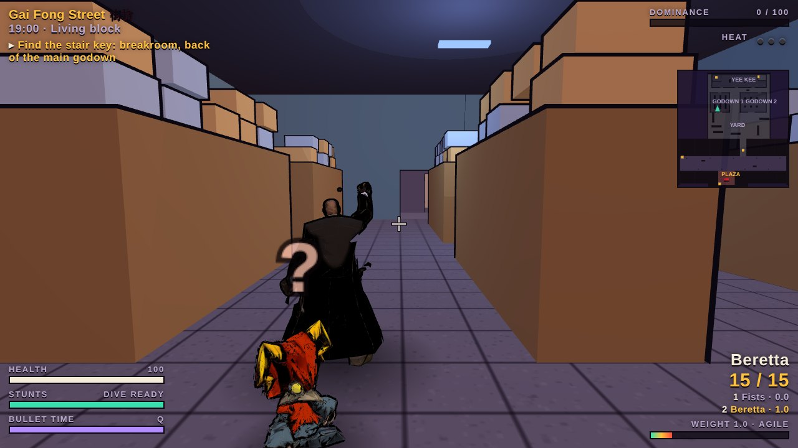
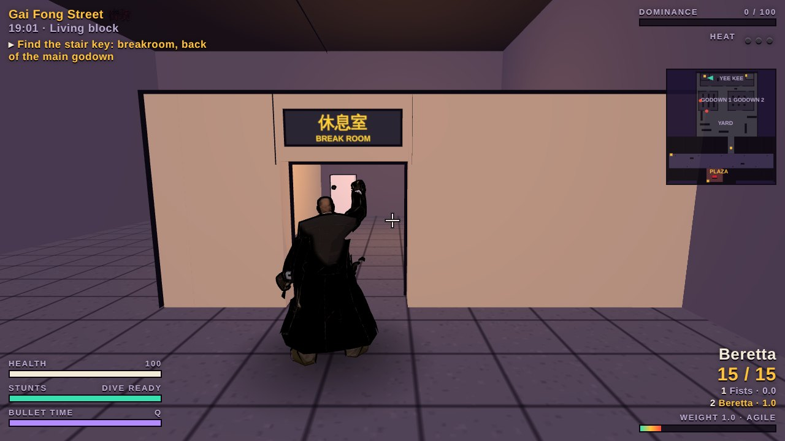
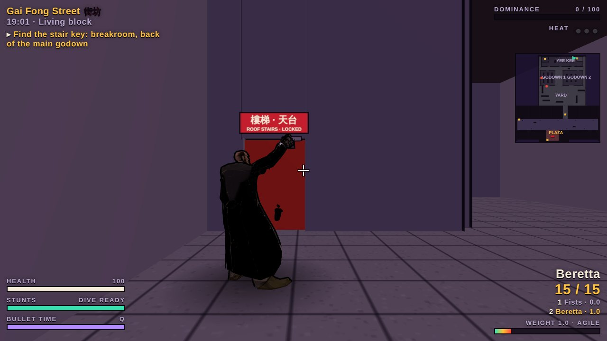
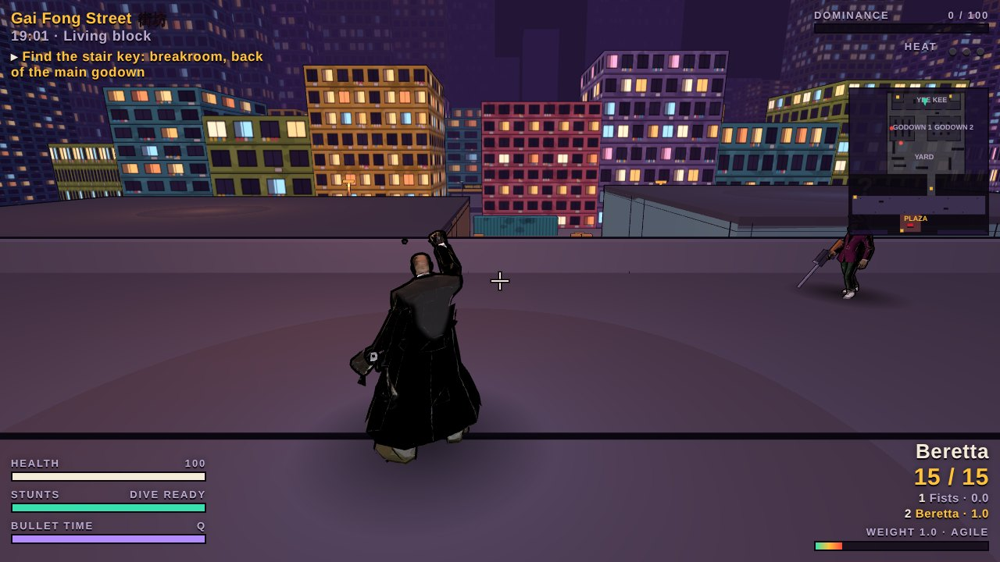
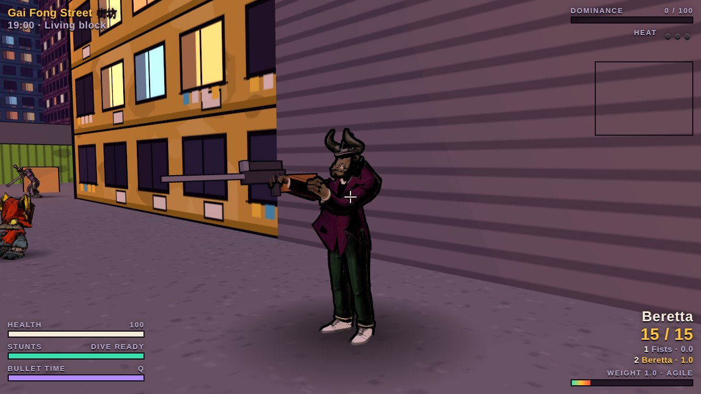
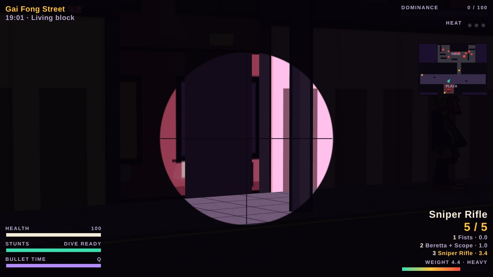

# The Regulars

A browser-playable prototype of **The Regulars**, a Hong Kong action-cinema game in the spirit of *The Specialists*. Everyone on Gai Fong Street has somewhere to be. Three of the regulars are hitmen waiting for you. Past the street, Yaki's crew runs a warehouse compound. Sneak through the godowns, lift the stair key from the breakroom and take Yaki down on the roof.

## Play

Live game: https://alfred909.github.io/the-regulars/

The published game files are in `docs/`. Serve that folder through a local web server for local play; opening the HTML directly from disk can block model loading. Internet access is required for the external libraries and fonts.

Needs a keyboard and mouse. Click in the street to lock the mouse.

## Controls

| Key | Action |
| --- | --- |
| W A S D | Move |
| Mouse | Look and aim |
| Left click | Shoot or punch |
| Right mouse | Aim / zoom (scopes zoom further) |
| Shift | Run |
| Z | Sneak: quiet, low, harder to spot |
| Space | Jump |
| C or middle click | Dive in any direction |
| Q | Bullet time |
| 1–5 or mouse wheel | Switch weapon |
| R | Reload |
| G | Drop weapon (lighter, more stunts) |
| M | Mute |
| Esc | Pause |

## The street

Regulars live their lives: noodles at the stall, a browse at the pawn shop, home before ten. Hitmen hide among them. A glint from a hitman's glasses gives him away when he's watching your back. Shoot a regular and the street turns on you.

## The compound

Two godowns full of racks and pallets, alleys covered from the roof, and the main Yee Kee godown at the back. Ma, Wa and Big Ma walk their beats. A **?** fills as they notice you. When it turns to **!**, they come for you. Sneak (Z), keep to cover, and punch an unaware guard from behind for a silent takedown.

The stair key is in the breakroom at the back of the main godown. The roof stairs are at the east end, behind a locked red door.

## The roof

Yaki watches the yard from the roof with a sniper rifle. A red laser shows where he's lining up a shot. Shoot at him from the ground and he ducks back from the edge, so you'll have to go up there.

Yaki drops his rifle when he goes down. Hold right mouse to scope in. There's also a scope to find for your pistol or SMG.

## Update the existing GitHub website

Your permanent local folder is C:\Users\keith\OneDrive\Documents\ChatGPT\The_Regulars. It is connected to https://github.com/Alfred909/the-regulars.git.

1. Open GitHub Desktop and select this repository. Use Repository → Show in Explorer to confirm the folder.
2. Fetch origin, then Pull origin if offered, before editing.
3. Edit `docs/index.html` for the game; put model changes in `docs/models/`. Save your files.
4. Review Changes, enter a summary, and Commit to main.
5. Push origin. GitHub Pages automatically publishes main /docs.
6. Check the repository Actions tab for a successful deployment, then refresh the live game.

Do not create a new repository or another main folder. The existing nested `main/` folder is an accidental separate repository, is ignored here, and is not used for this game.

## What's in here

- `docs/index.html`: the whole game (Three.js, loaded from a CDN)
- `docs/models/`: the rigged, animated characters (Guard, Glasses, Mr. Nestor, Chef, Ma, Big Ma, Wa, Yaki), stored as glTF JSON
- `docs/screenshots/`: images for this page and for the projects website

Characters were modelled in Tripo3D, then rigged and animated for the browser.
